<p align="center">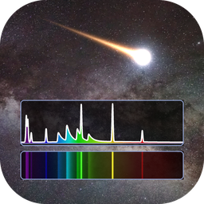</p>

<h1 align="center">METEORAD</h1>

<p align="center"><b>METEOr RADiation spectra</b><br>Specification and User Manual</p>

<p align="center">Python edition of SPRADIAN-1.8 (JAXA) — Version 1.0<br>Original code: SPRADIAN-1.8 — K. Fujita and T. Abe (ISAS/JAXA)<br>Additional atoms/molecules and GUI: Shinsuke Abe (阿部新助)<br>Document date: 2026-10-30</p>

> **Use of METEORAD requires citing Fujita & Abe (1997), Fujita & Abe (2003) and Abe et al. (2026) (Section 1.4).**

[日本語版](ja.md) ・ [PDF version](METEORAD_Manual_en.pdf) ・ [Word version](METEORAD_Manual_en.docx)

## Contents

- [1. Overview](#sec-1)
  - [1.1 Applications](#sec-1-1)
  - [1.2 Main features](#sec-1-2)
  - [1.3 Verification](#sec-1-3)
  - [1.4 Citation (required)](#sec-1-4)
- [2. Requirements and installation](#sec-2)
  - [2.1 Windows](#sec-2-1)
  - [2.2 macOS](#sec-2-2)
  - [2.3 Where the databases are stored](#sec-2-3)
  - [2.4 Uninstalling](#sec-2-4)
- [3. Start-up and window layout](#sec-3)
- [4. Species panel](#sec-4)
  - [4.1 Presets](#sec-4-1)
- [5. Parameter panel](#sec-5)
  - [5.1 Automatic pressure FWHM (Auto)](#sec-5-1)
- [6. Running and displaying spectra](#sec-6)
  - [6.1 Basic procedure](#sec-6-1)
  - [6.2 Plot-panel controls](#sec-6-2)
  - [6.3 Slab intensity](#sec-6-3)
- [7. Menus](#sec-7)
  - [7.1 Spectrum file format](#sec-7-1)
- [8. Temperature sweep](#sec-8)
- [9. Fitting an observed spectrum](#sec-9)
  - [9.1 Settings](#sec-9-1)
  - [9.2 Search method](#sec-9-2)
- [10. Importing VALD line lists](#sec-10)
- [11. Loading control files (.ctl)](#sec-11)
- [12. Python API](#sec-12)
- [13. Physical model and specifications](#sec-13)
  - [13.1 Units and conventions](#sec-13-1)
  - [13.2 Calculation flow](#sec-13-2)
  - [13.3 Line shapes](#sec-13-3)
  - [13.4 Instrument-function convolution](#sec-13-4)
- [14. Databases](#sec-14)
  - [14.1 Approximations for the added molecules](#sec-14-1)
  - [14.2 Adding species](#sec-14-2)
- [15. Limitations and cautions](#sec-15)
- [16. Credits and references](#sec-16)
  - [16.1 Required citations](#sec-16-1)
  - [16.2 Further references](#sec-16-2)
  - [16.3 Terms of use](#sec-16-3)

<a id="sec-1"></a>

## 1. Overview

**METEORAD** (METEOr RADiation spectra) computes line-by-line emission and absorption spectra of high-temperature plasmas. It is a Python port of JAXA's radiation code **SPRADIAN-1.8** (Structured Package for Radiation Analysis; K. Fujita and T. Abe, ISAS/JAXA); the physics, the database format and the control-file format follow the original C code.

This software is based on JAXA's SPRADIAN. Shinsuke Abe added further atoms and molecules important for atmospheric entry and meteor emission and built the GUI.

The METEORAD extensions — Python port, additional atoms/molecules, GUI, temperature sweeps, observed-spectrum fitting, Python API, etc. — are described in Abe et al. (2026) (Section 1.4).

<a id="sec-1-1"></a>

### 1.1 Applications

- Ablation emission of meteors and space debris (metal atoms, ions and metal oxides)
- Radiation of air plasmas around re-entry capsules (N₂, O₂, NO, N, O and their ions)
- Combustion-gas emission (C₂, CN, CH, OH, CO, ...)
- Estimating temperatures, number densities and instrument resolution by fitting observed spectra

<a id="sec-1-2"></a>

### 1.2 Main features

- Non-equilibrium five-temperature model (translational Ttr / rotational Trot / vibrational Tvib / electronic-excitation Tex / electron Tel)
- Bound-bound radiation (atomic lines and diatomic bands) and continua (bound-free, free-bound, free-free)
- Line shapes: Voigt / rectangular / Lorentzian; automatic estimate of the pressure FWHM (Stark + van der Waals)
- Uniform-slab line-of-sight intensity with self-absorption, and the blackbody at Tel
- Gaussian instrument-function convolution; spectra coloured by dominant species
- Batch temperature sweeps exported to CSV
- Fitting of observed spectra (grid search + linear least squares + Nelder–Mead refinement)
- Import of VALD line lists; reading SPRADIAN-1.8 control files (.ctl)
- Python API (run_spectrum) for calculations without the GUI

<a id="sec-1-3"></a>

### 1.3 Verification

For sample1.ctl of the C version (10 air species, 10000 K, 3000–3500 Å) the spectra and fluxes agree with SPRADIAN-1.8 to the printed precision (5 significant digits). For all added debris/metal species, the wavelengths of the strongest lines/band heads agree with literature values (tools/test_debris.py).

<a id="sec-1-4"></a>

### 1.4 Citation (required)

Any publication, presentation or report based on METEORAD **must cite all three of the following papers** in its acknowledgements/references.

1. Fujita K, Abe T (1997) SPRADIAN, structured package for radiation analysis: theory and application. ISAS Report No. 669, pp. 1–47. Institute of Space and Astronautical Science. https://jaxa.repo.nii.ac.jp/records/31438
2. Fujita K, Abe T (2003) Development of a radiation analysis code for hypervelocity reentry applications. ISAS Report SP No. 17, pp. 69–82. Institute of Space and Astronautical Science. https://jaxa.repo.nii.ac.jp/records/33242
3. Abe S, et al (2026) C₂, CH and CN emission, surface temperature and luminous efficiency of the Hayabusa2 sample-return capsule from ground-based slitless video spectroscopy. Earth, Planets and Space.

Fujita and Abe (1997) is the original SPRADIAN theory paper and Fujita and Abe (2003) describes the development of the radiation analysis code for hypervelocity reentry. Abe et al. (2026) describes the METEORAD extensions of SPRADIAN: the Python port, the additional atoms/molecules for atmospheric entry and meteor emission, the GUI, temperature sweeps, fitting of observed spectra, the Python API, etc.

> Example acknowledgement: "Spectra were computed with METEORAD (Fujita and Abe 1997, 2003; Abe et al. 2026)."

<a id="sec-2"></a>

## 2. Requirements and installation

METEORAD is distributed as a Windows installer and a macOS disk image (dmg). No Python or other additional software is required.

**Table 1.** Requirements and distribution files

| Item | Windows | macOS |
|---|---|---|
| OS | Windows 10 / 11 (64-bit) | macOS 14.4 or later, Apple Silicon (M1 or later) |
| File | `METEORAD-<ver>-Windows-x64-Setup.exe`<br>(portable: `METEORAD-<ver>-Windows-x64.zip`) | `METEORAD-<ver>-macOS-arm64.dmg` |
| Disk space | about 200 MB | about 150 MB |
| Code signing | none (SmartScreen warning on first run) | none (Gatekeeper check on first run) |

<a id="sec-2-1"></a>

### 2.1 Windows

1. Double-click `METEORAD-<ver>-Windows-x64-Setup.exe`.
2. If "Windows protected your PC" appears, choose **More info** → **Run anyway** (the installer is not code-signed).
3. Choose the install mode (only for me / all users). Installing for all users requires administrator rights.
4. Accept the terms of use, choose the destination (default `C:\Program Files\METEORAD`) and whether to create a desktop icon, then click **Install**.
5. Leave "Launch METEORAD" checked on the last page and click **Finish** to start it.

> To use the portable version, extract the zip anywhere and run `METEORAD\METEORAD.exe`; no installation is needed.

<a id="sec-2-2"></a>

### 2.2 macOS

1. Double-click `METEORAD-<ver>-macOS-arm64.dmg` to open it.
2. Drag **METEORAD.app** onto the **Applications** folder shown in the same window.
3. Open METEORAD from the Applications folder (or Launchpad). The first time, macOS reports that it cannot verify the developer; close the dialog with **Done** (or **OK**).
4. Open **System Settings** → **Privacy & Security**, click **Open Anyway** next to the message that "METEORAD" was blocked, and confirm with **Open** (only needed once).
5. You can then eject the dmg from the Finder sidebar.

<a id="sec-2-3"></a>

### 2.3 Where the databases are stored

Two databases are scanned at start-up and listed in the species panel.

**Table 2.** Database locations

| Group | Location | Contents |
|---|---|---|
| Air/Combustion | inside the application (read-only) | 23 air/combustion species of the original SPRADIAN DATAPAC |
| Debris/Metal | Windows: `%APPDATA%\METEORAD\database_debris`<br>macOS: `~/Library/Application Support/METEORAD/database_debris` | 20 debris/metal species and any species created by VALD import (Chapter 10) |

> The Debris/Metal folder is created automatically on first start and the bundled databases are copied into it. When the application is updated, files with the same names as the bundled ones are overwritten by the new version (other files are kept); if you replaced a bundled species, e.g. by a VALD import, save it under another name or keep a backup. After changing the folder, use **Tools → Rescan databases** to refresh the list.

<a id="sec-2-4"></a>

### 2.4 Uninstalling

- Windows: in **Settings → Apps → Installed apps**, select METEORAD and choose **Uninstall**.
- macOS: move METEORAD.app from the Applications folder to the Trash.
- In both cases the user data (the Debris/Metal folder above and the settings) is kept; delete the `METEORAD` folder if you no longer need it.

<a id="sec-3"></a>

## 3. Start-up and window layout

- Windows: start **METEORAD** from the Start menu (or the desktop icon).
- macOS: start **METEORAD** from the Applications folder or Launchpad.
- SPRADIAN-1.8 control files (.ctl) can be loaded after start-up with **File → Load control file (.ctl)** (Chapter 11).

Started from a command line, METEORAD can open a .ctl file directly or print its version.

```text
# Windows (PowerShell)
& "C:\Program Files\METEORAD\METEORAD.exe" sample1.ctl

# macOS (Terminal)
/Applications/METEORAD.app/Contents/MacOS/METEORAD sample1.ctl
/Applications/METEORAD.app/Contents/MacOS/METEORAD --version
```

The main window has four areas (Figure 1).

<p align="center">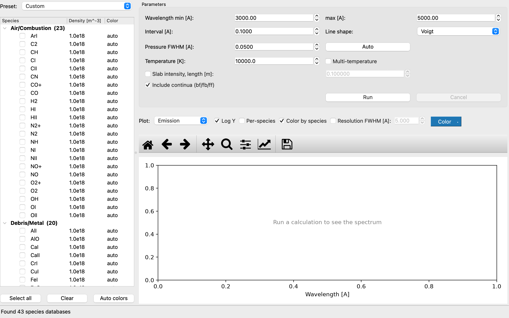</p>

<p align="center"><b>Figure 1.</b> Main window right after start-up</p>

**Table 3.** Main-window areas

| Area | Position | Purpose |
|---|---|---|
| Species panel | left | choose species, number densities and plot colours; presets |
| Parameter panel | top right | wavelength range, interval, line shape, pressure broadening, temperatures, slab length, continua; Run/Cancel |
| Plot panel | bottom right | result display (quantity, log axis, per-species, resolution, colour) |
| Status bar | bottom | progress, run time, electron density Ne and total density, value at the clicked point |

<a id="sec-4"></a>

## 4. Species panel

<p align="center">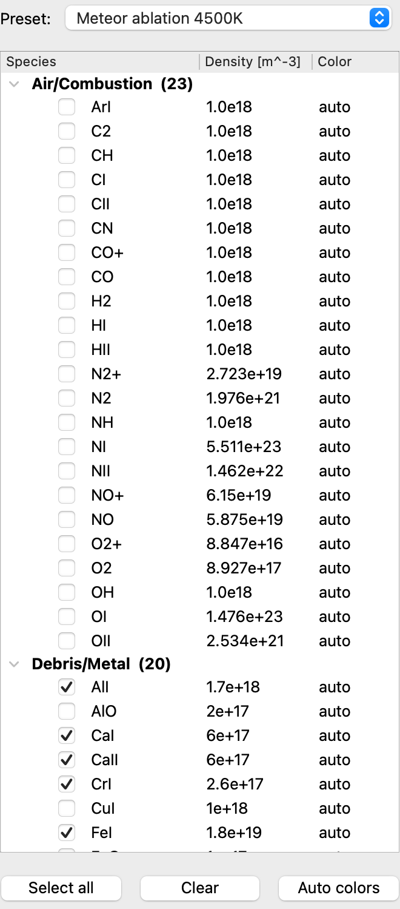</p>

<p align="center"><b>Figure 2.</b> Species panel (after the Meteor ablation 4500K preset)</p>

- Species are grouped as **Air/Combustion** (original DATAPAC) and **Debris/Metal** (database_debris).
- Checked species are included in the calculation.
- Double-click the **Density [m^-3]** column to edit the number density (e.g. `1.5e18`).
- Double-click the **Color** column to choose the species' plot colour. Back to the automatic colour: right-click → "Reset to auto color", the Delete key, or the **Auto colors** button. Colours are remembered across sessions.
- **Select all** / **Clear** check or uncheck every species.
- Editing checks or densities by hand switches the preset box to **Custom**.

<a id="sec-4-1"></a>

### 4.1 Presets

The Preset box sets a representative composition and temperature (the same value for all five temperatures) in one step.

**Table 4.** Presets

| Preset | Temperature | Composition [m⁻³] |
|---|---|---|
| Air plasma 10000K | 10000 K | equilibrium air of sample1.ctl: NI 5.511e23, OI 1.476e23, NII 1.462e22, OII 2.534e21, N2 1.976e21, NO+ 6.15e19, NO 5.875e19, N2+ 2.723e19, O2 8.927e17, O2+ 8.847e16 |
| Debris ablation 4000K | 4000 K | NaI 1e19, MgI 5e18, FeI 5e18, AlI 2e18, TiI 1e18, NiI 1e18, CuI 1e18, MgO 5e17, AlO 2e17, TiO 1e17, FeO 1e17 |
| Meteor ablation 4500K | 4500 K | CI-chondritic ratios scaled to Si = 2e19: SiI 2e19, MgI 2.1e19, FeI 1.8e19, AlI 1.7e18, NaI 1.1e18, NiI 1e18, CaI 6e17, CaII 6e17, CrI 2.6e17, MnI 1.9e17, KI 7.4e16, TiI 4.8e16 |
| Custom | — | manual settings (no preset applied) |

> Preset compositions are representative values; set the densities for your own conditions in real analyses.

<a id="sec-5"></a>

## 5. Parameter panel

<p align="center">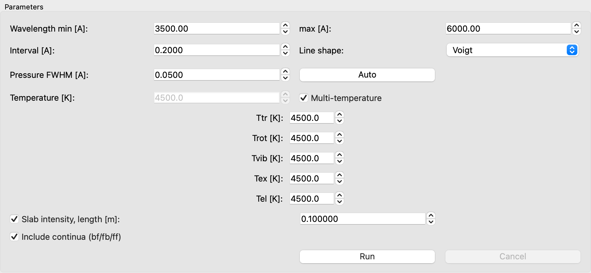</p>

<p align="center"><b>Figure 3.</b> Parameter panel (multi-temperature mode, slab intensity on)</p>

**Table 5.** Parameters

| Field | Unit | Description |
|---|---|---|
| Wavelength min / max | Å | Wavelength range. Editing it inside the computed range only zooms the plot; extending it outside triggers an automatic re-run. |
| Interval | Å | Wavelength grid spacing |
| Line shape | — | Voigt / Rectangular / Lorentzian |
| Pressure FWHM | Å | Full width at half maximum of pressure broadening (Lorentzian part). The Doppler width is computed from Ttr. |
| Auto | — | Estimates the pressure FWHM from the selected densities and temperature (Section 5.1) |
| Temperature | K | Equilibrium temperature (applied to all five) |
| Multi-temperature | K | When checked, set Ttr, Trot, Tvib, Tex and Tel individually |
| Slab intensity, length | m | Compute the uniform-slab line-of-sight intensity (Section 6.3) |
| Include continua (bf/fb/ff) | — | Include bound-free, free-bound and free-free continua |
| Run / Cancel | — | Start / stop the calculation (stops at the next species or stage boundary) |

**Table 6.** Five-temperature model

| Temperature | Meaning | Mainly controls |
|---|---|---|
| Ttr | translational | Doppler width, van der Waals width |
| Trot | rotational | rotational populations of molecules (band shape) |
| Tvib | vibrational | vibrational populations (relative band intensities) |
| Tex | electronic excitation | electronic-state populations (line intensities) |
| Tel | electron | ionisation, continua, blackbody temperature |

<a id="sec-5-1"></a>

### 5.1 Automatic pressure FWHM (Auto)

The Auto button estimates the sum of the Stark and van der Waals widths at the centre λ of the wavelength range. The electron density Ne follows from the ion densities by charge neutrality; the neutral density N₀ enters the van der Waals term.

```text
FWHM = Stark + vdW
Stark ∝ λ² · Ne,      vdW ∝ λ² · (N₀ / N_ref) · (Ttr / 296 K)^0.3
```

> The estimate is an order-of-magnitude value. For precise work, fit it to observations (Chapter 9) or use literature values. Without ion species the Stark term is 0.

<a id="sec-6"></a>

## 6. Running and displaying spectra

<a id="sec-6-1"></a>

### 6.1 Basic procedure

1. Pick a preset in the species panel, or check species and enter number densities.
2. Set the wavelength range, interval, temperatures, etc. in the parameter panel.
3. Press **Run**. The calculation runs in a background thread; databases are cached between runs.
4. The result appears in the plot panel; the status bar shows run time, Ne, total density and the number of grid points.

<p align="center">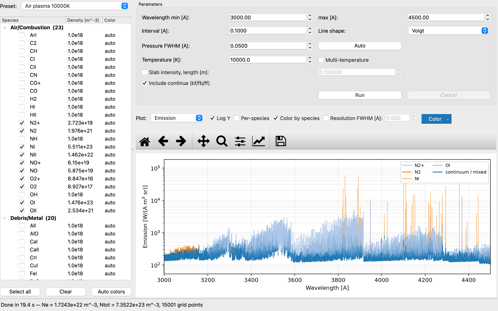</p>

<p align="center"><b>Figure 4.</b> Air plasma at 10000 K (3000–4500 Å, log scale, coloured by dominant species)</p>

<a id="sec-6-2"></a>

### 6.2 Plot-panel controls

**Table 7.** Plot-panel controls

| Control | Function |
|---|---|
| Plot | Quantity: Emission / Absorption / Slab intensity / Blackbody (Tel) |
| Log Y | Logarithmic y axis |
| Per-species | Overlay each species' emission in its own colour (total drawn faintly) |
| Color by species | Draw the total spectrum in the colour of the species contributing ≥ 50 % of the line emission at each wavelength; continuum/mixed regions use the Color-button colour. |
| Resolution FWHM | Convolve the displayed spectrum with an area-conserving Gaussian instrument function; saved CSV files gain convolved columns. |
| Color | Spectrum line colour; "Reset to default" in its menu restores the default. |
| Observed | Overlay the observed spectrum after a fit (Chapter 9) |
| Toolbar | matplotlib standard: home, back/forward, pan, zoom, subplots, axes, save |
| Click | Shows wavelength, value and dominant species of the nearest grid point in the status bar |

<p align="center">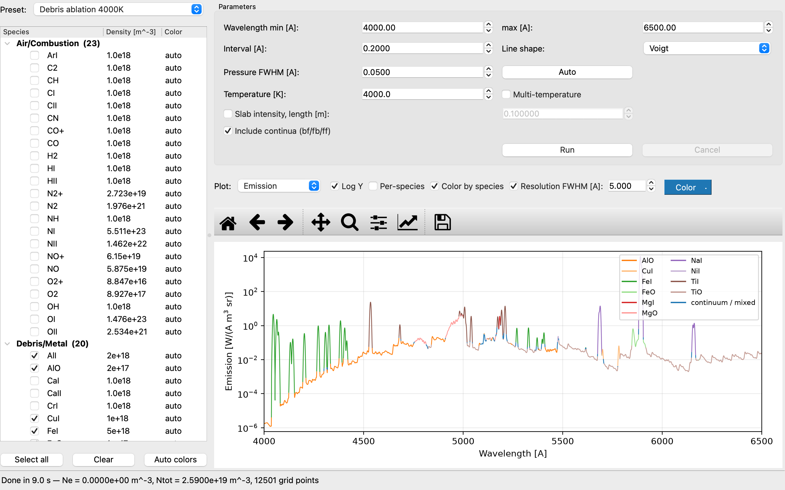</p>

<p align="center"><b>Figure 5.</b> Debris ablation 4000K (4000–6500 Å, 5 Å resolution, coloured by species, log scale)</p>

<p align="center">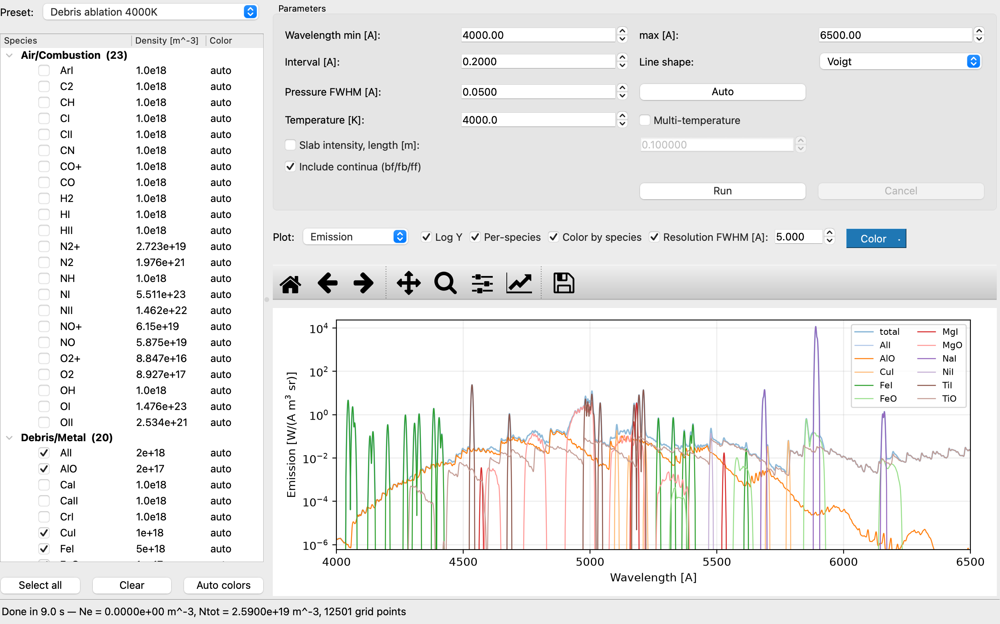</p>

<p align="center"><b>Figure 6.</b> Same run in Per-species mode (each species' emission overlaid)</p>

<a id="sec-6-3"></a>

### 6.3 Slab intensity

With Slab intensity checked and a slab length L [m], the intensity emerging from a uniform plasma layer of thickness L is computed including self-absorption (same formula as 1D-tool/Self-abs of the C version).

```text
I(λ) = ε(λ) / κ(λ) · [1 − exp(−κ(λ) L)]
  optically thin (κL ≪ 1): I → ε L     optically thick (κL ≫ 1): I → ε/κ (bounded by the blackbody)
```

<p align="center">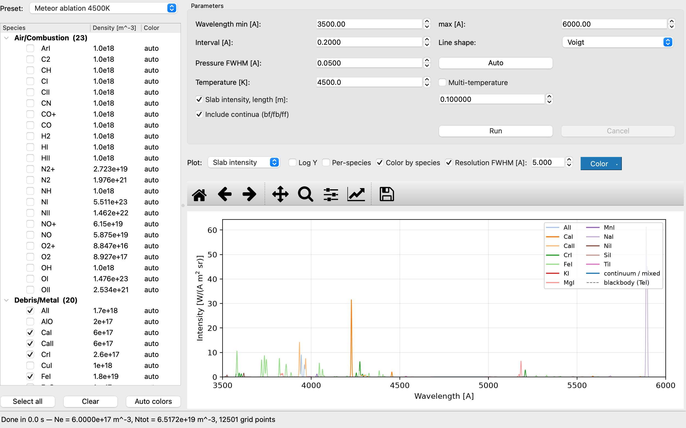</p>

<p align="center"><b>Figure 7.</b> Slab intensity of Meteor ablation 4500K (L = 0.1 m, 5 Å resolution)</p>

<a id="sec-7"></a>

## 7. Menus

<p align="center">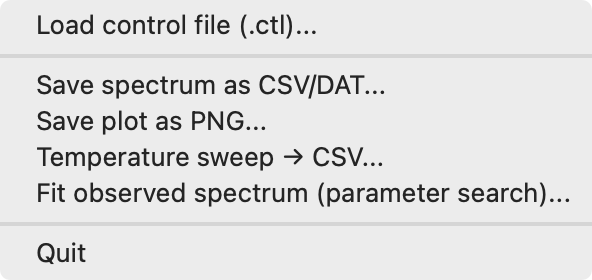</p>

<p align="center"><b>Figure 8.</b> File menu</p>

**Table 8.** Menu items

| Menu | Item | Function |
|---|---|---|
| File | Load control file (.ctl)... | Load a SPRADIAN-1.8 job control file into the form (Chapter 11) |
| File | Save spectrum as CSV/DAT... | Save the spectrum as CSV (comma) or DAT (space-delimited) (Section 7.1) |
| File | Save plot as PNG... | Save the current plot as PNG |
| File | Temperature sweep → CSV... | Batch temperature sweep (Chapter 8) |
| File | Fit observed spectrum (parameter search)... | Fit an observed spectrum (Chapter 9) |
| Tools | Import VALD line list... | Convert a VALD extract to a .dat file (Chapter 10) |
| Tools | Rescan databases | Rescan the database directories and refresh the species list |
| Help | About | Version, credits and units |

<a id="sec-7-1"></a>

### 7.1 Spectrum file format

With a .csv suffix the file is comma-separated with one header line; otherwise it is space-separated with a `#` header. Numbers use `%.6e`.

**Table 9.** Columns of the spectrum CSV/DAT

| Column | Unit | Present when |
|---|---|---|
| wavelength_A | Å | always |
| emission_W/(A.m3.sr) | W Å⁻¹ m⁻³ sr⁻¹ | always |
| absorption_1/m | m⁻¹ | always |
| intensity_W/(A.m2.sr) | W Å⁻¹ m⁻² sr⁻¹ | slab intensity computed |
| blackbody_W/(A.m2.sr) | W Å⁻¹ m⁻² sr⁻¹ | always (blackbody at Tel) |
| emission_conv&lt;F>A / intensity_conv&lt;F>A | as above | Resolution FWHM = F enabled |

<p align="center">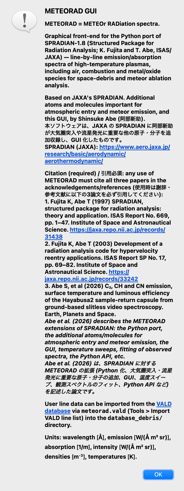</p>

<p align="center"><b>Figure 9.</b> About dialog (credits and units)</p>

<a id="sec-8"></a>

## 8. Temperature sweep

File → Temperature sweep → CSV... keeps every other main-window parameter fixed (wavelength range, grid, line shape, pressure FWHM, slab, continua) and computes spectra of one checked species, or of the checked mixture, over a range of temperatures, saving all of them into one CSV.

<p align="center">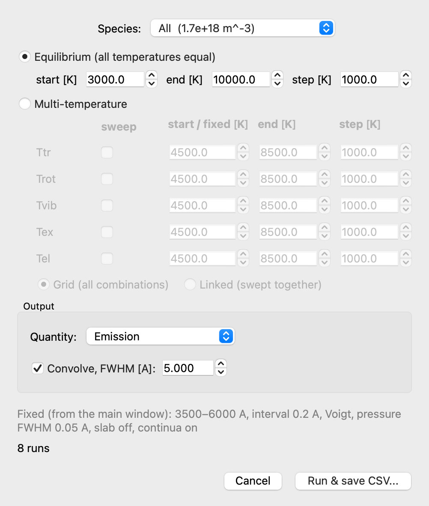</p>

<p align="center"><b>Figure 10.</b> Temperature-sweep dialog (equilibrium mode)</p>

- **Equilibrium**: one temperature T swept by start / end / step and applied to all five components (default for atoms).
- **Multi-temperature**: each of Ttr, Trot, Tvib, Tex, Tel is fixed or swept. Swept components are combined as **Grid** (all combinations) or **Linked** (advanced together; needs equal numbers of points). Default for molecules: Trot + Tvib linked.
- **Quantity**: Emission / Absorption coefficient / Slab intensity (slab intensity only when it is enabled in the main window).
- **Convolve, FWHM**: convolve every spectrum with a Gaussian instrument function before saving.

<p align="center">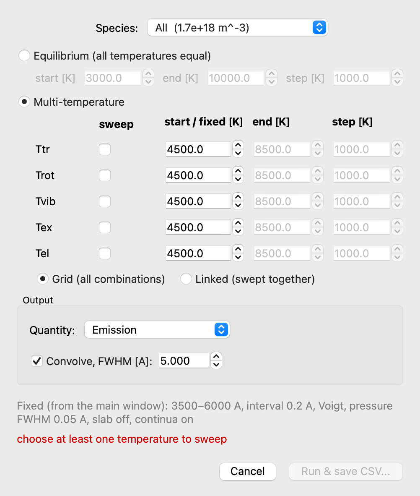</p>

<p align="center"><b>Figure 11.</b> Temperature-sweep dialog (multi-temperature mode)</p>

The CSV starts with `#` metadata lines, followed by `wavelength_A` and one column per temperature set (e.g. `T=5000K`, `Trot=3000K Tvib=4000K`). Read it with pandas as follows.

```text
import pandas as pd
df = pd.read_csv("sweep.csv", comment="#")
```

<a id="sec-9"></a>

## 9. Fitting an observed spectrum

File → Fit observed spectrum... opens the fit window. It loads an observed spectrum and searches temperatures, number densities, pressure FWHM and instrument resolution for the species checked in the main window. Wavelength interval, line shape, slab length and continua are taken from the main window when Run search is pressed.

<p align="center">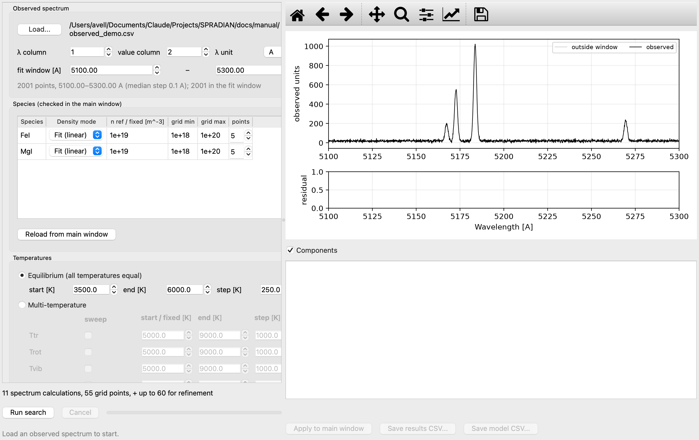</p>

<p align="center"><b>Figure 12.</b> Fit window: loading the observation and setting up the search</p>

<a id="sec-9-1"></a>

### 9.1 Settings

**Table 10.** Fit-window settings

| Group | Item | Description |
|---|---|---|
| Observed spectrum | Load... / λ column / value column / λ unit | Text/CSV observation; column numbers (1-based) and wavelength unit (A, nm, um) |
| Observed spectrum | fit window [A] | Wavelength range used in the fit |
| Species | Density mode | Fit (linear): solved by linear least squares (emission model only) / Grid (log): log-spaced min–max / Fixed |
| Temperatures | Equilibrium / Multi-temperature | Same as the temperature sweep (Chapter 8) |
| Broadening | Pressure FWHM | Fixed / Range (searched) / Auto (physical estimate at every point) |
| Broadening | Resolution FWHM | None / Fixed / Range (searched) |
| Model | Model | Emission (optically thin, fast) / Slab intensity (self-absorption, full run per point) |
| Model | Observed units | Arbitrary: a scale factor is fitted (only density ratios determined) / Absolute: observation in model units |
| Model | Baseline | None / Constant / Linear (absorbs stray light / unmodelled continuum) |
| Model | Refine the best point | Continuous Nelder–Mead refinement from the best grid point |

<a id="sec-9-2"></a>

### 9.2 Search method

- **Emission model**: one full run per (temperature set, pressure FWHM) at the reference densities; each species' line emission is a basis vector scaled by its density. The continuum (total − lines) is one more basis vector with a non-negative amplitude.
- **Slab-intensity model**: one full run per (temperature set, pressure FWHM, density-grid combination).
- Figure of merit: sum of squared residuals over the fit window, reported as relative RMS = √(Σr² / Σobs²).
- Limits: 2000 full spectrum runs, 500000 linear solves. The best 50 solutions are kept with their model arrays.

<p align="center">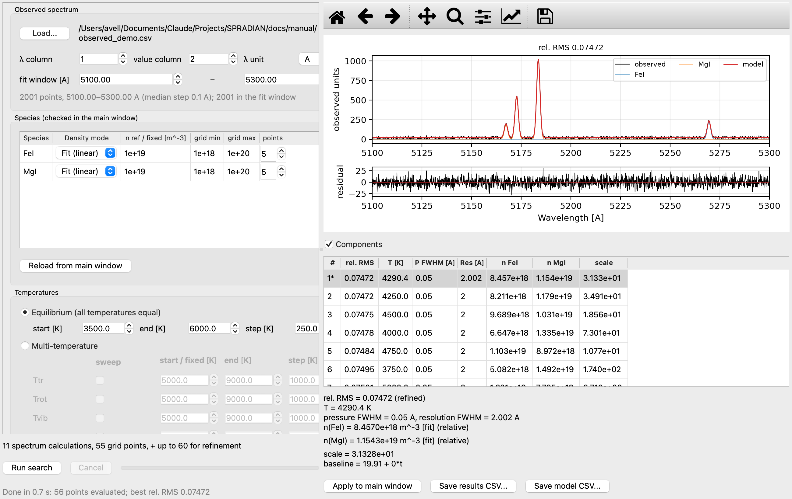</p>

<p align="center"><b>Figure 13.</b> Fit result: observed (black), model (red), components, residuals and the table of evaluated points</p>

The example in Figure 13 fits a synthetic 5100–5300 Å spectrum (MgI + FeI + NaI, 4300 K, Mg/Fe = 1.33, 2 Å resolution, noise added) with MgI and FeI. It recovers T = 4290 K, Mg/Fe = 1.36 and a resolution of 2.00 Å (the relative RMS of 0.075 is the added noise).

Selecting a row shows that solution. **Apply to main window** copies its temperatures, densities, pressure FWHM and resolution into the main window, re-runs and overlays the observation (Figure 14). **Save results CSV** stores the parameters and errors of all evaluated points; **Save model CSV** stores observation, model, residual and components of the selected solution on the observed wavelengths.

<p align="center">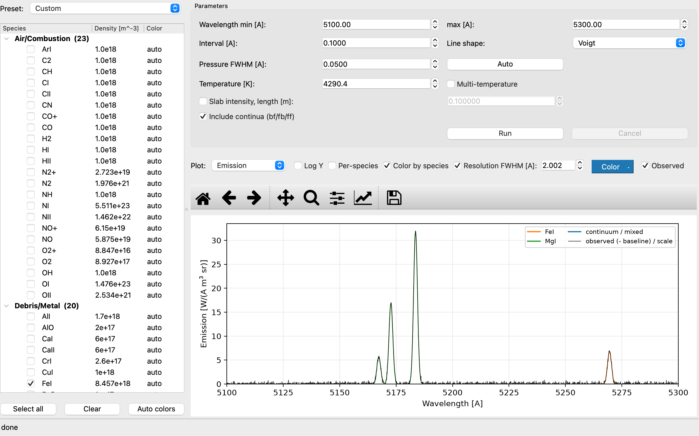</p>

<p align="center"><b>Figure 14.</b> Result of Apply to main window (observed spectrum overlaid)</p>

> With Observed units = Arbitrary only density ratios are meaningful (shown values are relative). Use an absolutely calibrated observation with Absolute to obtain absolute densities.

<a id="sec-10"></a>

## 10. Importing VALD line lists

Tools → Import VALD line list... converts a VALD3 long-format extract (https://www.astro.uu.se/valdwiki/) into a SPRADIAN atomic .dat file in the Debris/Metal folder (Section 2.3).

1. Register with VALD and request an Extract Element (long format) for the element/ionisation stage.
2. Choose the extract (.vald, .txt, .gz) via Import VALD line list....
3. Select the species to import from the list found in the file.
4. The level table and line list are generated and the species list is rescanned; the status bar shows the numbers of levels and lines.

```text
# conversion (verified)
A_ul [s^-1] = 6.6702e15 · gf / (g_u · λ_Ų)
Ae [W/sr]   = 1e10 · h c · A_ul / (4π λ_Å)
Ak [m² Å]   = A_ul · λ_Å⁴ · 1e-30 / (8π c g_l)
```

> When publishing results based on VALD data, follow the VALD citation rules.

<a id="sec-11"></a>

## 11. Loading control files (.ctl)

File → Load control file (.ctl)... reads a SPRADIAN-1.8 job file and applies wavelength range, interval, line shape, pressure FWHM, temperatures and species densities to the form. Items the form cannot represent are listed in a dialog after loading.

**Table 11.** Limitations of .ctl loading

| Control-file setting | GUI handling |
|---|---|
| Densities in an external file | not loaded (enter manually) |
| Temperatures in an external file | not loaded (enter manually) |
| Per-species temperature sets (multi-control) | the first set is applied to all species |
| Wave-file grids | min/max with a default interval |
| Pressure FWHM 'auto' | replaced by 0.05 Å |
| Species without a database file | skipped |

<a id="sec-12"></a>

## 12. Python API

The computational core `meteorad` needs only numpy and can be used from scripts without the GUI.

```text
from meteorad.runner import run_spectrum
from meteorad.models import Temperature

res = run_spectrum(
    ["NI", "OI"], [5.511e23, 1.476e23],
    Temperature(tr=1e4, ro=1e4, vi=1e4, ex=1e4, el=1e4),
    wl_min=7000.0, wl_max=8000.0, interval=0.5,
    db_dir="../SPRADIAN-1.8/DATAPAC/database",
    slab_length=0.1,          # optional: uniform-slab intensity
)
# res.wavelengths [Å], res.emission [W/(Å m³ sr)], res.absorption [1/m],
# res.intensity [W/(Å m² sr)], res.blackbody, res.per_species_emis, ...

from meteorad.control import read_control_file   # legacy job files
```

**Table 12.** Core modules

| Module | Content (C counterpart) |
|---|---|
| database.py | load_species(): fixed-column .dat parser (Read_Data) |
| control.py | read_control_file(): .ctl parser (Read_Parm) |
| population.py | populations and partition functions (Gene_Popu, InptThrm) |
| wavegrid.py / lineshape.py | wavelength grid; Voigt (Whiting approx.), rectangular, Lorentzian shapes |
| bound_bound.py | bound-bound line spectra (BounBoun) |
| continuum.py | bound-free, free-bound, free-free (BounFree/FreeBoun/FreeFree) |
| spectrum.py | assembly, blackbody, slab intensity, output (Gene_Spec, Gene_Blck, Self-abs) |
| runner.py | run_spectrum(): high-level API (CalSpec main) |
| vald.py | VALD long format → .dat conversion |

<a id="sec-13"></a>

## 13. Physical model and specifications

<a id="sec-13-1"></a>

### 13.1 Units and conventions

**Table 13.** Units

| Quantity | Unit |
|---|---|
| Wavelength | Å |
| Emission coefficient ε | W Å⁻¹ m⁻³ sr⁻¹ |
| Absorption coefficient κ | m⁻¹ |
| Intensity, blackbody | W Å⁻¹ m⁻² sr⁻¹ |
| Number density | m⁻³ |
| Temperature | K |
| Energies inside .dat files | K (= cm⁻¹ × 1.4387687) |

> Wavelength convention (as in the original): atomic line lists use **air wavelengths** above 2000 Å, molecular band lines use **vacuum wavelengths** (λ = K_LAMBDA_CONV / E).

<a id="sec-13-2"></a>

### 13.2 Calculation flow

run_spectrum() follows the same order as CalSpec main of the C version.

```text
read databases (.dat) → populations (5 temperatures) → bound-bound → bound-free / free-bound / free-free
→ assemble spectrum (ε, κ) → blackbody B(Tel) → [slab intensity] → output
```

<a id="sec-13-3"></a>

### 13.3 Line shapes

- **Voigt**: Doppler width (from Ttr and mass) and the Lorentzian pressure FWHM combined with the Whiting approximation, evaluated at grid points.
- **Rectangular / Lorentzian**: averaged over grid cells (last element unused). Rectangular suits molecular bands on coarse grids.
- Voigt lines narrower than the grid spacing alias. Use a spacing ≤ half the line width, or combine with the resolution convolution.

<a id="sec-13-4"></a>

### 13.4 Instrument-function convolution

Resolution FWHM convolves with a unit-area Gaussian, conserving integrated flux. At the grid ends the kernel is renormalised over the part inside the grid, so the edges do not droop.

<a id="sec-14"></a>

## 14. Databases

**Table 14.** Species in the databases

| Group | Species |
|---|---|
| Air/Combustion (original DATAPAC, 23) | ArI, C2, CH, CI, CII, CN, CO, CO+, H2, HI, HII, N2, N2+, NH, NI, NII, NO, NO+, O2, O2+, OH, OI, OII |
| Debris/Metal — neutral atoms (13) | NaI, MgI, AlI, SiI, KI, CaI, TiI, CrI, MnI, FeI, NiI, CuI, LiI |
| Debris/Metal — ions (3) | CaII, MgII, SiII |
| Debris/Metal — metal oxides (4) | MgO (B–X green), AlO (B–X blue-green), TiO (A–X γ, C–X α), FeO (orange, envelope approx.) |

<a id="sec-14-1"></a>

### 14.1 Approximations for the added molecules

- **AlO B²Σ⁺–X²Σ⁺**: the ²Σ states are written as S = 0 singlets (spin splitting ~0.007 cm⁻¹ is far below the grid). The common factor cancels in the partition function.
- **TiO**: X³Δ / A³Φ / C³Δ are approximated as ³Π (coupling case 23). The degeneracy 6 is correct, but the three γ-system heads (7054/7089/7126 Å) merge into one (~7125 Å).
- **FeO orange system**: a dense multi-state problem represented as one upper state (Te = 17050 cm⁻¹, S = 2, Λ = 0) giving the band envelope only; not for rotational-line work.
- **Franck–Condon factors**: Morse potentials built from (we, wexe, Be) and the reduced mass; vibrational overlaps computed numerically (revised 2026-10-23).

**Table 15.** Morse-oscillator Franck–Condon factors (A_total is the v′=0 total rate 1/τ₀)

| Band system | rₑ′ / rₑ″ (Å) | q00 | q01 | q10 | A_total (s⁻¹) |
|---|---|---|---|---|---|
| MgO B–X | 1.732 / 1.743 | 0.985 | 0.015 | 0.015 | 2.0e7 |
| AlO B–X | 1.667 / 1.618 | 0.730 | 0.238 | 0.225 | 1.0e7 |
| TiO γ (A–X) | 1.665 / 1.620 | 0.721 | 0.236 | 0.235 | 5.0e6 |
| TiO α (C–X) | 1.694 / 1.620 | 0.407 | 0.378 | 0.348 | 1.6e7 |
| FeO orange | 1.630 / 1.620 | 0.984 | 0.016 | 0.015 | 3.0e6 |

<a id="sec-14-2"></a>

### 14.2 Adding species

- Atoms: VALD import (Chapter 10) or `tools/make_atomic_dat.py` (NIST levels and A values).
- Diatomics: add state constants and band systems to `tools/make_diatomic_dat.py`; FCFs are computed automatically.
- Afterwards check loading and peak positions with `tools/test_debris.py`. Format details: docs/DATA_FORMATS_ja.md and notes/PORT_NOTES_database.md.

<a id="sec-15"></a>

## 15. Limitations and cautions

- The added debris-atom .dat files have no bound-free / free-bound blocks, so recombination continua of these species are absent (free-free uses the rough effective charge EffC2 = 0.01).
- Some A values come from log gf conversions with ±10–30 % uncertainty; replace them via VALD import for precise work.
- The Qe partition-function tables cover 1500–7000 K; above ~8000 K level truncation makes them incomplete. For Tex ≥ 5000 K the Qe tables are used.
- TiO and FeO carry the approximations of Section 14.1. Morse FCFs are good to a few % at low v; errors can be larger at high v′.
- The triatomic path (CO₂ etc.) is not implemented.
- The Python edition does not include the C version's 1D/2D radiative-transfer tools (Ray-integ, 1D-slab, S-cap, 3D-integ); only the uniform slab is available.

<a id="sec-16"></a>

## 16. Credits and references

This software is based on JAXA's SPRADIAN. Shinsuke Abe added further atoms and molecules important for atmospheric entry and meteor emission (database_debris/) and built the GUI (meteorad_gui/). The original SPRADIAN-1.8 is by K. Fujita and T. Abe (ISAS/JAXA).

<a id="sec-16-1"></a>

### 16.1 Required citations

Any use of METEORAD must cite all three papers below in the acknowledgements/references.

1. Fujita K, Abe T (1997) SPRADIAN, structured package for radiation analysis: theory and application. ISAS Report No. 669, pp. 1–47. Institute of Space and Astronautical Science. https://jaxa.repo.nii.ac.jp/records/31438
2. Fujita K, Abe T (2003) Development of a radiation analysis code for hypervelocity reentry applications. ISAS Report SP No. 17, pp. 69–82. Institute of Space and Astronautical Science. https://jaxa.repo.nii.ac.jp/records/33242
3. Abe S, et al (2026) C₂, CH and CN emission, surface temperature and luminous efficiency of the Hayabusa2 sample-return capsule from ground-based slitless video spectroscopy. Earth, Planets and Space.

Fujita and Abe (1997) is the original SPRADIAN theory paper and Fujita and Abe (2003) describes the development of the radiation analysis code for hypervelocity reentry. Abe et al. (2026) describes the METEORAD extensions of SPRADIAN: the Python port, the additional atoms/molecules for atmospheric entry and meteor emission, the GUI, temperature sweeps, fitting of observed spectra, the Python API, etc.

<a id="sec-16-2"></a>

### 16.2 Further references

- JAXA Aeronautical Technology Directorate, Advancement of the thermal-aerodynamic evaluation system for atmospheric entry vehicles (SPRADIAN; in Japanese): https://www.aero.jaxa.jp/research/basic/aerodynamic/aerothermodynamic/
- SPRADIAN-1.5 User's Manual (2.3rd ed., Japanese), ISAS/JAXA
- S. Abe, N. Ebizuka, H. Yano, J. Watanabe and J. Borovička, Detection of the N₂⁺ First Negative System in a Bright Leonid Fireball, ApJ 618, L141 (2005)
- Huber, K. P. and Herzberg, G., Constants of Diatomic Molecules
- NIST Atomic Spectra Database; VALD3 (https://www.astro.uu.se/valdwiki/)

<a id="sec-16-3"></a>

### 16.3 Terms of use

The SPRADIAN-derived code and DATAPAC are JAXA intellectual property; copying, modification, redistribution, commercial use and other acts requiring the right holder's permission are governed by JAXA's “Guide to the Use of Intellectual Property” (2024.9 ed., Japanese) and require a licence agreement with JAXA: https://www.jaxa.jp/about/ip_policy/data/chizairiyou_tebiki_202409.pdf

See TERMS_en.txt / TERMS_ja.txt in the distribution for details.

